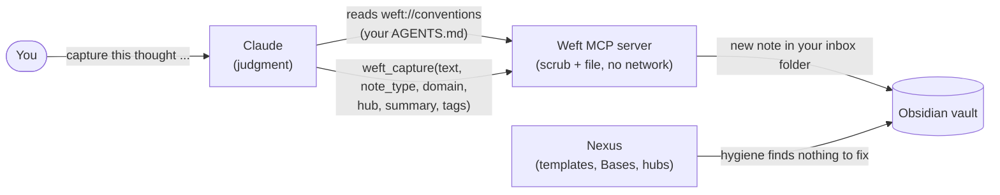
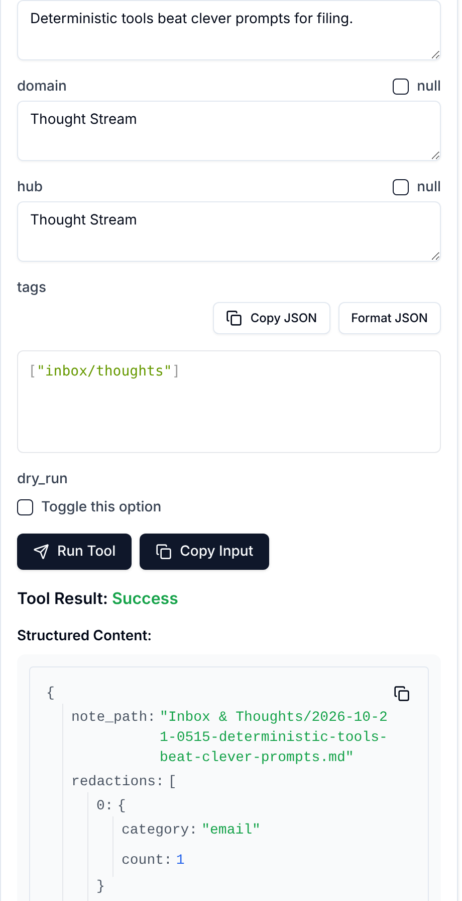

# Weft

Weft is a privacy-first MCP server for your local Obsidian vault. You tell Claude what to capture or look up. Claude does the thinking, and Weft does the deterministic part: it scrubs secrets, emails and phone numbers out of every note it writes and every snippet it returns, files new notes in your inbox folder, searches the vault, and ranks existing notes as link candidates. Weft makes no network calls, holds no API keys, and never edits or deletes an existing note.

The full spec and roadmap live in [WEFT.md](WEFT.md). What it offers today (milestones 0-4 of WEFT.md):

- `weft_vault_info`: which vault the server is bound to
- `weft_scrub`: redact secrets, emails and phone numbers, with a counts-only report
- `weft_capture`: scrub text and file it as a new note in your inbox folder (never overwrites; `dry_run` previews)
- `weft_search`: full-text search ranked by term frequency, with scrubbed snippets
- `weft_suggest_links`: rank existing notes as `[[wikilink]]` candidates by the rare words they share; the agent decides what to link
- `weft://conventions` (a resource): your vault's `AGENTS.md`, when it has one

Not yet:

- Your own `redact_terms` list (milestone 6), so company names and codenames are not redacted today.
- Excluding folders from search and link suggestions. A note in `Security/` is still searchable; its snippets are scrubbed, but the note is not skipped.

## Setup

Requires Python 3.14 and [uv](https://docs.astral.sh/uv/) 0.13+ (`brew upgrade uv`). `uv sync` fetches everything else.

```sh
uv sync
uv run weft config detect                  # vaults Obsidian knows about on this machine
uv run weft config set-vault "/path/to/vault"
uv run weft config set-inbox "Inbox & Thoughts"   # optional: where captures go (default: inbox)
uv run weft config show
```

### Where is my vault?

Weft has no built-in vault path. At startup it takes the first of:

1. `weft serve --vault <path>`
2. `WEFT_VAULT=<path>`
3. the saved setting from `weft config set-vault` (`~/.config/weft/config.json`)

If none is set it refuses to start and tells you how to fix it. On a new laptop, just run `weft config detect` and `set-vault` again.

### Try it in the MCP Inspector

The [MCP Inspector](https://github.com/modelcontextprotocol/inspector) is a web UI that talks to the server the way Claude would, so you can call each tool by hand before wiring up a client:

```sh
npx @modelcontextprotocol/inspector@0.17.2 /path/to/Weft/.venv/bin/weft serve
```

The version is pinned because the screenshots below were taken with 0.17.2; newer Inspector releases have a different layout, though Weft behaves the same. Open the URL it prints, click **Connect**, then **Tools → List Tools**, pick a tool and **Run Tool**:


### Use it from Claude Code

```sh
claude mcp add --transport stdio --scope user weft -- /path/to/Weft/.venv/bin/weft serve
```

Use the venv binary, not `uv run`: Claude Desktop may not have `uv` on its PATH, and the binary needs no install step at launch. Options such as `-e` must come **before** the server name; anything after `--` is passed to `weft serve`. The vault comes from `weft config set-vault`, so you don't need `-e`. To pin a vault in the client config instead, use `claude mcp add --transport stdio --scope user -e WEFT_VAULT=/path/to/vault weft -- /path/to/Weft/.venv/bin/weft serve`.

### Use it from Claude Desktop

Add Weft to `claude_desktop_config.json` (on macOS, `~/Library/Application Support/Claude/claude_desktop_config.json`) and restart Claude Desktop:

```json
{
  "mcpServers": {
    "weft": {
      "command": "/path/to/Weft/.venv/bin/weft",
      "args": ["serve"]
    }
  }
}
```

### Use it with a vault that has an AGENTS.md

If your vault keeps its rules for AI agents in an `AGENTS.md` at its root (frontmatter fields, folders, hubs), Weft hands that file to Claude as the `weft://conventions` resource and tells it to follow the file when capturing. Claude picks the values that need judgment; Weft scrubs and files the note. The result looks like a note your other tools made, so a plugin such as Nexus accepts it without rewriting it.



Here is that capture call made by hand in the Inspector, with the fields Claude would fill from your AGENTS.md:



The note then comes out like this (the email was scrubbed before anything touched the disk):

```markdown
---
title: "今天学了MCP：server 只做确定性的事，判断交给 agent。Ping me at [REDACTED:email]"
created: 2026-10-19T05:38:42+00:00
source_type: thought
type: "reflection"
domain: "Thought Stream"
hub: "[[Thought Stream]]"
summary: "MCP server 只做确定性操作，判断留给 agent。"
tags:
  - "inbox/thoughts"
scrubbed: true
redactions:
  - { category: "email", count: 1 }
---
```

`hub` must be an existing note, and a call with an unknown hub fails before anything is written. Vaults without an `AGENTS.md` get none of this and work as before.

## Develop

```sh
uv run pytest
```

Layers, one-way dependencies (`cli → server → tools → (vault, domain)`): `config`/`discovery` answer *where*, `vault` is the safe filesystem boundary, `scrub`/`capture`/`search`/`links` are the domain code (plain Python), `tools/` are thin MCP adapters (the tools plus the conventions resource), `server.py` is the composition root. Only `server.py` and `tools/` import `mcp`.
