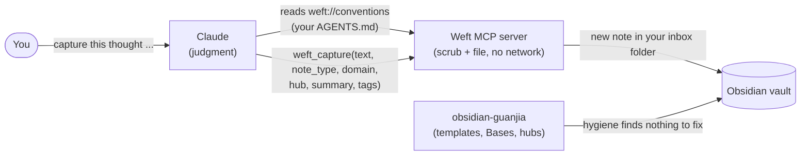

# Weft

Privacy-first MCP server that weaves daily media, spontaneous thoughts, and project workflows into your local Obsidian graph. It extracts abstract technical patterns and metadata while stripping sensitive data like tokens or client names, seamlessly updating your vault with cross-linked, long-term knowledge.

The full spec and roadmap live in [WEFT.md](WEFT.md). Tools (milestones 0-4 of WEFT.md):

- `weft_vault_info`: which vault the server is bound to
- `weft_scrub`: redact secrets, emails and phone numbers, with a counts-only report
- `weft_capture`: scrub text and file it as a new note in `inbox/` (never overwrites; `dry_run` previews)
- `weft_search`: full-text search ranked by term frequency
- `weft_suggest_links`: rank existing notes as `[[wikilink]]` candidates; the agent decides what to link

Not yet: your own `redact_terms` list (milestone 6), so company names and codenames are not redacted today.

## Setup

Requires Python 3.14 and [uv](https://docs.astral.sh/uv/) 0.13+ (`brew upgrade uv`). `uv sync` fetches everything else.

```sh
uv sync
uv run weft config detect                  # vaults Obsidian knows about on this machine
uv run weft config set-vault "/path/to/vault"
uv run weft config set-inbox "Inbox & Thoughts"   # optional: where captures go (default: inbox)
uv run weft config show
```

### Where is my vault?

Weft has no built-in vault path. At startup it takes the first of:

1. `weft serve --vault <path>`
2. `WEFT_VAULT=<path>`
3. the saved setting from `weft config set-vault` (`~/.config/weft/config.json`)

If none is set it refuses to start and tells you how to fix it. On a new laptop, just run `weft config detect` and `set-vault` again.

### Use it from Claude Code

```sh
claude mcp add --transport stdio --scope user weft -- /path/to/Weft/.venv/bin/weft serve
```

Use the venv binary, not `uv run`: Claude Desktop may not have `uv` on its PATH, and the binary needs no install step at launch. Options such as `-e` must come **before** the server name; anything after `--` is passed to `weft serve`. The vault comes from `weft config set-vault`, so you don't need `-e`. To pin a vault in the client config instead, use `claude mcp add --transport stdio --scope user -e WEFT_VAULT=/path/to/vault weft -- /path/to/Weft/.venv/bin/weft serve`.

### Use it with a vault that has an AGENTS.md

If your vault keeps its rules for AI agents in an `AGENTS.md` at its root (frontmatter fields, folders, hubs), Weft hands that file to Claude as the `weft://conventions` resource and tells it to follow the file when capturing. Claude picks the values that need judgment; Weft scrubs and files the note. The result looks like a note your other tools made, so a plugin such as obsidian-guanjia accepts it without rewriting it.



A capture then comes out like this (the email was scrubbed before anything touched the disk):

```markdown
---
title: "今天学了MCP：server 只做确定性的事，判断交给 agent。Ping me at [REDACTED:email]"
created: 2026-10-19T05:38:42+00:00
source_type: thought
type: "reflection"
domain: "Thought Stream"
hub: "[[Thought Stream]]"
summary: "MCP server 只做确定性操作，判断留给 agent。"
tags:
  - "inbox/thoughts"
scrubbed: true
redactions:
  - { category: "email", count: 1 }
---
```

`hub` must be an existing note, and a call with an unknown hub fails before anything is written. Vaults without an `AGENTS.md` get none of this and work as before.

## Develop

```sh
uv run pytest
```

Layers, one-way dependencies (`cli → server → tools → vault`): `config`/`discovery` answer *where*, `vault` is the safe filesystem boundary, `tools/` are thin MCP adapters (the tools plus the conventions resource), `server.py` is the composition root. Only `server.py` and `tools/` import `mcp`.
