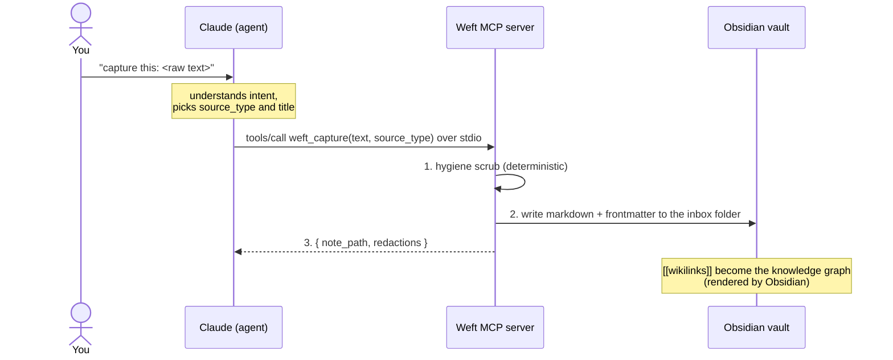
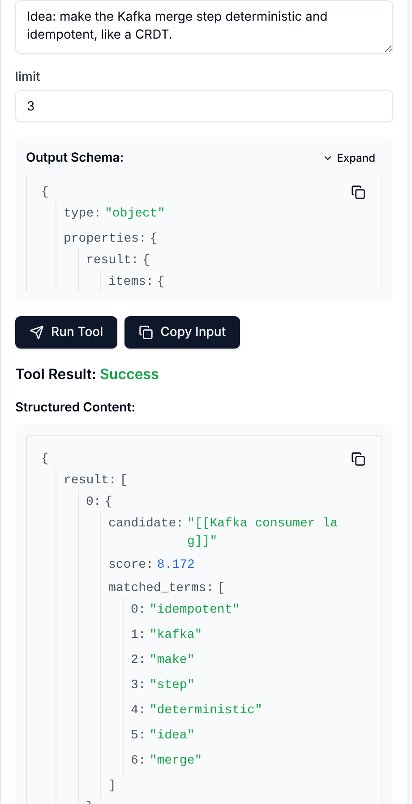

# WEFT.md — Project Spec (v0.1)

> Weft (n.): a thread woven through fabric to bind it together.
> Weft is a privacy-first personal MCP server that turns chaotic daily inputs
> into clean, linked Obsidian notes — so fleeting thoughts become a knowledge
> graph instead of evaporating.

---

## 1. The mental model: agent vs. MCP server

This is the single most important section. Read it before writing any code.

- **The agent (Claude Code / Claude Desktop) does the thinking.** It understands
  your intent, decides which tool to call, summarizes, extracts entities,
  chooses tags, and writes prose.
- **The Weft MCP server does the doing.** It exposes deterministic tools:
  scrub text, write a file, search the vault, propose links. It makes no
  network calls, holds no API keys, and never "decides" anything fuzzy.
- **Rule of thumb:** if it requires judgment, it belongs in the agent. If it's
  a deterministic operation on local data, it belongs in the server.



## 2. Design principles

1. **Solid first, fancy later.** v0.1 is a few small tools and one read-only
   resource, well-tested. Nothing more.
2. **Deterministic over clever.** The server does exact, testable operations
   (regex, file I/O, token overlap). All fuzzy work lives in the agent.
3. **Local-only.** stdio transport. No network calls from the server, ever.
   The vault lives on disk.
4. **Obsidian-native.** Frontmatter + `[[wikilinks]]`. Weft does not build a
   graph database — Obsidian already renders the graph. Weft's job is to write
   notes worth graphing.
5. **Hygiene is enforced, not optional.** Every write path runs through the
   scrubber. There is no tool that writes raw unscrubbed text to the vault.

## 3. Privacy architecture (the core innovation)

Two layers. v0.1 ships layer 2; layer 1 is parked (see §8).

- **Layer 1 — scrub-at-capture (future):** a tiny local CLI (`weft scrub`)
  that cleans clipboard text *before* it reaches the LLM. This is the only
  layer that prevents raw text from leaving the machine, because in MCP the
  agent always sees your input before calling a tool.
- **Layer 2 — scrub-at-store (v0.1):** the server scrubs every write. This
  guarantees the vault stays clean no matter which client calls the server,
  and makes notes safe to sync, share, or publish later.

### What gets redacted (v0.1, deterministic)

| Category | Method | Marker |
|---|---|---|
| Credentials & secrets | Regex: `sk-…`, `ghp_…`, `github_pat_…`, `xox…`, `AKIA…`, `-----BEGIN … PRIVATE KEY-----`, `password\s*[:=]`, bearer tokens, generic `api[_-]?key\s*[:=]\s*\S+` | `[REDACTED:credential]` |
| Email addresses | Regex | `[REDACTED:email]` |
| Phone numbers | Regex (NA + international-ish) | `[REDACTED:phone]` |
| Configured terms | User's `redact_terms` list (milestone 6, not built yet): company name, project codenames, team names, internal URLs | `[REDACTED:term]` |

Markers are visible on purpose — you should *see* what was removed.

The redaction report carries **counts by category only** (`{term: 2}`), never the
matched text. Writing the matched text into frontmatter or logs would make the report
itself the leak.
Every scrub returns a report: `{ redactions: [{category, count}], scrubbed_text }`.
Deliberately out of scope for v0.1: ML-based PII/NER detection (fuzzy → belongs
in a later layer, or in the agent's judgment).

## 4. v0.1 tools (five, atomic) and one resource

### `weft_scrub`
- **In:** `{ text: string }`
- **Out:** `{ scrubbed_text, redactions: [{category, count}] }`
- **Behavior:** pure function, no file I/O. Runs the §3 patterns (`redact_terms`
  joins them in milestone 6).
- **Why first:** the testable core. Table-driven unit tests live here.

### `weft_capture`
- **In:** `{ text: string, source_type: enum, source?: string, title_hint?: string,
  note_type?: string, summary?: string, domain?: string, hub?: string,
  tags?: string[], dry_run?: bool }`
- `source_type`: `article | news | video | thought | book | seminar | work | conversation | other`
- **Out:** `{ note_path, redactions }`
- **Behavior:**
  1. Run `weft_scrub` on `text`.
  2. Generate filename: `YYYY-MM-DD-HHmm-<slug>.md` (slug = up to 10 CJK
     characters kept as-is, then the first ~5 lowercase words,
     ASCII-folded and hyphenated).
  3. Write to the inbox folder with frontmatter (see §6). `inbox/` by default;
     `weft config set-inbox "<folder>"` points it at the vault's own inbox.
  4. Never overwrites: on collision, append `-2`, `-3`.
- **Note:** the agent supplies `source_type` and `title_hint` from its
  understanding of your message — the server just files deterministically.

### `weft_search`
- **In:** `{ query: string, limit?: number }` (default limit 10)
- **Out:** `[{ path, snippet, score }]`
- **Behavior:** case-insensitive full-text search over `*.md` in the vault,
  ranked by simple term frequency. Snippet = ~2 lines around first match,
  scrubbed before it is returned (the note may hold a secret the scrubber
  would have caught at capture time).

### `weft_suggest_links`
- **In:** `{ note_path: string }` or `{ text: string }`
- **Out:** `[{ candidate: "[[Note Title]]", score, matched_terms: [...] }]`
- **Behavior:** scrub both sides, then tokenize (stopword-filtered, CJK as
  two-character terms), so `matched_terms` never carries a piece of a secret;
  score existing notes by overlap, each shared term weighted by how rare it is
  in the vault (BM25 IDF), so boilerplate every note shares counts for almost
  nothing. Notes the input already links to are skipped. Deterministic
  ranking; the *agent* decides which links to insert.
- **Why not auto-link:** linking is a judgment call → belongs in the agent.

### `weft_vault_info`
- **In:** nothing. **Out:** `{ root, is_obsidian_vault, note_count, conventions_file }`
- **Behavior:** reports which vault the server is bound to. Milestone 0's
  proof-of-wiring tool, and the first call to make when something looks wrong.

### Resource `weft://conventions`
- **What:** the vault's own `AGENTS.md` (frontmatter fields, folders, hubs),
  scrubbed, offered only when the vault has one. The server instructions tell
  the agent it exists.
- **Why a resource:** it *shows* context the agent reads before capturing; it
  does nothing. Choosing a `domain` or `hub` from it is judgment → agent.

## 5. Vault layout and configuration

```
<vault>/
  inbox/              # fresh captures land here (weft_capture writes here)
  ...                 # the rest of the vault: Weft reads it, never changes it
```

`inbox/` is only the default. A vault that already has an inbox points Weft at
it with `weft config set-inbox "<folder>"` (below). Moving a capture out of the
inbox, into a folder and a template, is not Weft's job: you do it by hand, or
a plugin such as Nexus does it inside Obsidian (§12).

**The vault location is never hard-coded and never stored inside the vault**
(a config file in the vault can't tell you where the vault is). It is resolved
at startup, first hit wins:

1. `weft serve --vault <path>`
2. `WEFT_VAULT` environment variable
3. user config file (`~/.config/weft/config.json`, written by
   `weft config set-vault <path>`; `WEFT_CONFIG` overrides its location)

No hit → the server refuses to start and says how to fix it. It never guesses.
`weft config detect` lists vaults from Obsidian's own registry, which is how
you re-point Weft after moving to a new machine.

`inbox_dir` lives in the same user config file (`weft config set-inbox`). It is
vault-relative, must stay inside the vault, and defaults to `inbox`.
`redact_terms` is still to come: it names your sensitive terms, so storing it
*inside* a vault you sync or publish would leak the very list the scrubber
hides. It goes in the user config file too.

## 6. Note format

```markdown
---
title: "Why MCP servers should be deterministic"
created: 2026-10-11T02:30:00-04:00
source_type: article
source: "https://example.com/mcp-notes"
tags: []
scrubbed: true
redactions:
  - { category: "term", count: 2 }
---

<scrubbed body text>
```

- `type` (from `note_type`), `domain`, `hub` and `summary` are written only
  when the agent supplies them,
  in between `source` and `tags`. They exist so a captured note matches the
  vault's own conventions (an AGENTS.md, say) and the user's other tools accept
  it as is. `hub` must be an existing note and is written as `"[[Hub]]"`.
- `tags` starts empty unless the agent passes some; the agent may propose tags, you confirm.
- Body is the scrubbed text, verbatim otherwise — the server does not
  summarize or rewrite (judgment → agent).

## 7. Tech stack

Python 3.15, `mcp` (official Python SDK, v2.x — `MCPServer` + `@mcp.tool()`
decorator), `uv` for project/environment management, `pytest` for tests.
stdio transport.

Why Python and not the TypeScript stack from the todo guide: you already think
in Python, and Weft is about learning MCP — not a second language at the same
time. The MCP concepts are identical (tools, schemas, lifecycle); the Python
SDK generates input schemas from type hints, so there is no zod equivalent to
learn and the `@mcp.tool()` decorator reads like plain Python. This path was
verified end-to-end (2026-10-11): venv install, stdio `initialize →
tools/list → tools/call`, a valid call returns the scrubbed result, and
invalid input is rejected before the tool function runs.

Project layout:
```
weft/
  pyproject.toml          # uv project; `weft` console script
  src/weft/
    config.py             # WHERE is the vault (flag > env > user config)
    discovery.py          # read-only: vaults Obsidian already knows about
    vault.py              # safe filesystem boundary (path-escape guard, note listing)
    tools/                # thin MCP adapters, one module per tool or resource: register(mcp, vault)
    server.py             # composition root: build_server(vault) -> MCPServer
    cli.py                # `weft serve`, `weft config show|detect|set-vault|set-inbox`
    scrub.py              # (milestone 1) hygiene layer, pure functions
    capture.py            # (milestone 2) frontmatter + filename generation + inbox write
    search.py             # (milestone 3) term-frequency search, pure functions
    links.py              # (milestone 4) token-overlap link suggestions, pure functions
  tests/                  # one file per layer; test_cli_stdio.py runs the real server
```

Dependency direction is one-way: `cli → server → tools → (vault, domain)`;
`config` and `discovery` are standalone. Only `server.py` and `tools/` import
`mcp`, so domain code stays plain, testable Python.

Run locally: `uv run weft serve` (stdio JSON-RPC), or without uv:
`/absolute/path/to/weft/.venv/bin/weft serve`.

## 8. Explicitly NOT v0.1 (parked, not forgotten)

- Layer-1 `weft scrub` CLI pre-filter (privacy §3)
- Auto-tagging / entity extraction via embeddings (needs a model; fuzzy → agent)
- `daily_digest` (that's an agent *prompt*, not a server tool — candidate for
  MCP Prompts in v0.2)
- MCP Resources for the notes themselves (v0.1 exposes only the vault's
  AGENTS.md, as `weft://conventions`)
- Mobile capture shortcut, cloud sync
- An Obsidian plugin, for good: Nexus is the in-Obsidian companion (§12)
- Anything with a network call

## 9. Build order (milestones)

0. **Foundation (done):** config resolution, vault boundary, server wiring,
   CLI, `weft_vault_info` as the one proof-of-wiring tool, tests per layer
1. `weft_scrub` with pytest parametrized tests (the core — get this right) (done)
2. `weft_capture` (frontmatter + file writing + collision handling) (done)
3. `weft_search` (done)
4. `weft_suggest_links` (done)
5. `claude mcp add` → dogfood for one week on real daily inputs (next, after
   the phase 4 read boundary below)
6. Per-vault settings (`redact_terms`; `inbox_dir` is done) + README polish

Planning talks in phases. This is how they map to the milestones:

| Phase | Milestones | Status |
|---|---|---|
| 1 | 0, the foundation | done |
| 2 | 1-2, `weft_scrub` and `weft_capture` | done |
| 3 | 3-4, `weft_search` and `weft_suggest_links`, plus `weft://conventions` | code done (v0.1.0) |
| 4 | a single read boundary, excluded folders, `redact_terms` (6), `weft_read_note`, then the dogfood week (5) | next |
| 5 | shaped by the dogfood week: a contract block in the vault's AGENTS.md, linked captures, possibly guarded edits | later |

**Definition of done for v0.1:** you capture 10 real thoughts across a week,
every one scrubbed and filed without you touching a file by hand, and
`suggest_links` surfaces at least one connection you wouldn't have made.

## 10. How to build with Claude Code

v0.1 is built. To keep working on Weft with Claude Code (or any coding agent),
point it at [AGENTS.md](AGENTS.md), which has the commands and the rules, and at
the phase you're on in §9. The tutor protocol in §11 still applies to new
milestones.

## 11. Builder-as-tutor protocol

The AI building Weft is also the teacher. After each milestone (§9), it must
do three things before moving on — briefly, no lectures:

1. **Name the concept** just implemented, in ≤5 lines, tied to the code just
   written. (E.g. after milestone 1: "You just saw bad input rejected before
   your function ran — that's input validation from your type hints, the same
   protection zod gave you in the todo guide, now free.")
2. **Give one command to try yourself.** Something you can run in the next
   60 seconds that makes the concept tangible.
3. **Point at one thing to notice.** (E.g. "Watch the JSON-RPC `tools/call`
   request in the Inspector — that's the exact moment the agent hands control
   to your server.")

Every tool also gets a one-line **"why a tool"** note: why this is a Tool and
not a Resource or a Prompt. (Rule of thumb: tools *do* things, resources
*show* things, prompts *package* reusable instructions.)

**Concept checklist — all covered by end of v0.1:**

| Milestone | Concept you will understand |
|---|---|
| 1 — scrub | Tool definition via `@mcp.tool()`, input schemas auto-generated from type hints, invalid input rejected before your code runs, pure functions as tools |
| 2 — capture | stdio transport, the `initialize → tools/list → tools/call` lifecycle, server-side file I/O |
| 3 — search | Tool design (limits, ranking), returning structured results the agent can reason over |
| 4 — suggest_links | Where the server stops and the agent starts (ranking vs. deciding) |
| 5 — `claude mcp add` | Client configuration, scopes, Inspector debugging when a call fails |
| `weft://conventions` | Resources vs. tools: context the agent reads, not an action; server instructions as the hint that it exists |

## 12. Usage guide — from built to daily habit

### Your first 15 minutes (do this the day v0.1 is done)

1. **Inspector:** run `npx @modelcontextprotocol/inspector@0.17.2 /absolute/path/to/weft/.venv/bin/weft serve`
   (pinned to the version the GIF was recorded with; newer releases have a different layout),
   open the URL it prints, click **Connect**, then **Tools → List Tools →
   weft_scrub**. Run it with
   `My key is sk-abc123XYZ456def and my email is paul@example.com`.
   Watch the redaction report — that's your hygiene layer working.

   
2. **Claude Code:** run `claude mcp add --transport stdio --scope user weft -- /absolute/path/to/weft/.venv/bin/weft serve`
   (options like `-e` go before the server name; the vault comes from `weft config set-vault`),
   then say: *"capture this thought: just realized deterministic tools beat
   clever prompts for filing"*. Open your inbox folder (`inbox/`, unless you
   ran `weft config set-inbox "<folder>"`) — your note is there, frontmatter
   and all.
3. **Obsidian:** open the vault, find the note, switch to Graph view.
   One node. Come back after a week of captures and watch it grow.

### Per-tool concrete examples

**`weft_scrub` — "is this safe to store?"**
Paste anything work-adjacent into the Inspector first. If the report shows
`[REDACTED:term]` hits, your `redact_terms` list is doing its job. Once
`redact_terms` lands (milestone 6), tune it until real work notes come back clean.

**`weft_capture` — the daily driver.**
In Claude Code or Claude Desktop, just talk:
- *"capture this article: <paste> — source_type article"*
- *"quick thought: Bible study tonight was about stewardship"*
- *"I read a PR that used CRDTs for collaborative editing, work-related"*
  → the agent picks `source_type: work`, the server scrubs company terms
  (once `redact_terms` lands in milestone 6),
  the note lands in your inbox folder with `scrubbed: true`.

**`weft_search` — "what did I think about X?"**
*"search my vault for CRDT"* → you get paths + snippets. This is the moment
the project pays off: your past self answering your present self.

**`weft_suggest_links` — "what connects?"**
After ~10 notes: *"what should my note on CRDTs link to?"* → ranked
`[[candidates]]` with matched terms. You (or the agent, at your direction)
insert the links. Open Graph view and see threads appear.



*The same call in the Inspector, on a four-note demo vault. On a vault this
small, everyday words such as `make` and `step` still count; the rarity
weighting matters more as the vault grows.*

### With an AGENTS.md vault and Nexus

Each part does what it is good at, and none of them repeats another's job:

| Part | Owns | Does not |
|---|---|---|
| **Claude** (the agent) | Judgment: which `note_type`, `domain`, `hub`, `summary`, `tags`; which suggested links are real | Touch the disk directly |
| **Weft** (this server) | Scrubbing, filing into the inbox folder, search, link ranking, handing over `AGENTS.md` | Call a model, or decide anything fuzzy |
| **Nexus** (in Obsidian) | Templates, Bases tables, hubs, hygiene, moving notes into their domain | Need to rewrite Weft's notes: they already carry the fields its hygiene check looks for |

Setup, once: `weft config set-inbox "Inbox & Thoughts"`. Then in Claude Code,
say *"capture this thought: …"*. Claude reads `weft://conventions`, fills the
vault fields and calls `weft_capture`. In Obsidian, Nexus's hygiene check
finds nothing to fix, and the note digest its classification audit sends
already has the note's `type`, `domain` and `summary`.

### A day in the life (the end goal, in miniature)

- **Morning:** article → `weft_capture` → filed in 5 seconds, no filing system to maintain.
- **Work:** PR insight → captured with `source_type: work` → company terms auto-redacted (once `redact_terms` lands) → safe in your personal vault.
- **Evening:** fleeting thought → captured → `weft_suggest_links` connects it to last week's book note → new idea you wouldn't have had.
- **Weekend:** `weft_search` across the week → review in Obsidian graph → inspiration compounds.

That's the whole loop: capture without friction, hygiene without thinking,
connections without manual gardening.
